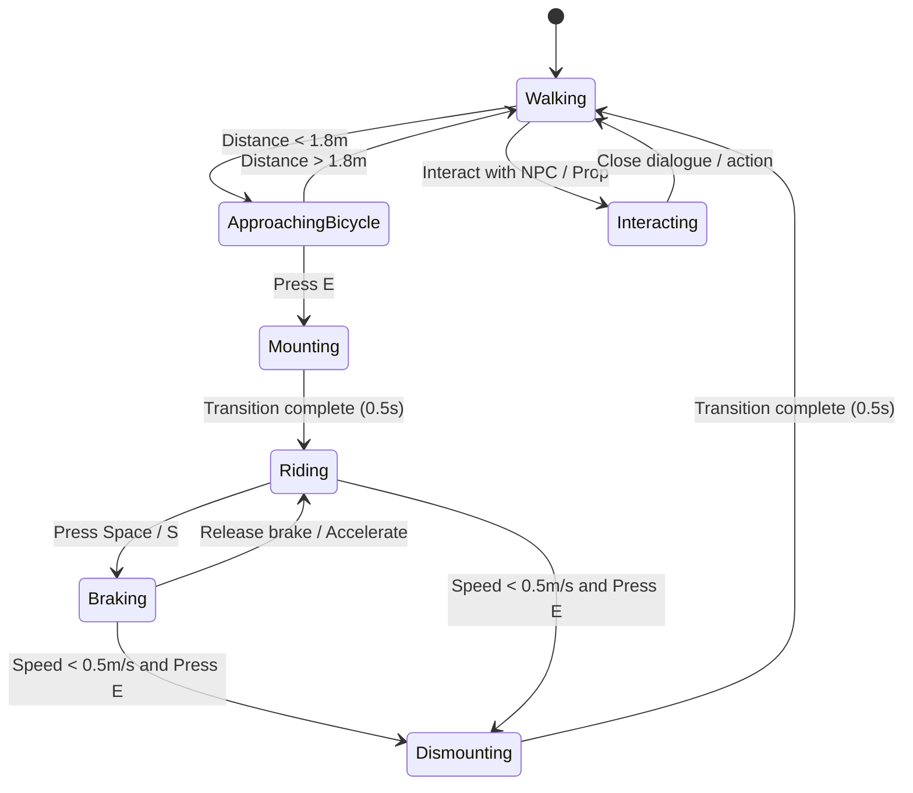

# 48 — Player Walking and Riding State Machine

**Project:** BEFORE THE FIRST LIGHT  
**Date:** 2026-11-21  
**Author:** Character & Animation Engineer (Expert 04), Chief Technical Architect (Expert 01)

---

## 1. Unified Locomotion State Architecture

Locomotion is governed by an authoritative state controller (`src/systems/movement/playerLocomotionState.ts`) ensuring that walking inputs and bicycle inputs never conflict.

---

## 2. State Invariants

- While `Riding`, walking interaction prompts for props (like sweeping or inspecting wheat) are suppressed.
- While `Walking`, bicycle controls (pedal cadence, bell, steering lean) are inactive.
- While `Mounting` or `Dismounting`, all keyboard inputs are safely queued or ignored to prevent animation glitches.
- When dialogue opens, bicycle velocity automatically decelerates to 0.

---

## 3. Visual Representation

- **Walking:** Stylized procedural bipedal gait with arm swings, spine sway, and subtle foot planting.
- **Riding:** Character seated on saddle, hands gripping handlebars, spine tilted forward at 14°, feet placed on pedals with knees bending dynamically as pedals revolve.
- **Dismounted Bicycle:** Rests securely on its kickstand with front wheel turned slightly at 12°.
