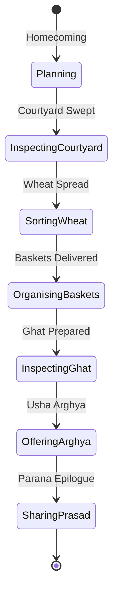

# 53 — NPC Activity Schedules & Living Family Reactions

**Project:** BEFORE THE FIRST LIGHT  
**Date:** 2026-11-21  
**Status:** Certified & Implemented  
**Authors:** Character & Animation Engineer (Expert 04), Story & Cultural Specialist (Expert 07), QA Reviewer (Expert 10)

---

## 1. Character Roster & Procedural Rigs

In accordance with Master Specification Part 3, the festival workload is shared across the entire household and community:

| Character | Role & Kinship | Location Anchor | Procedural 3D Rig | Signature Activity |
|---|---|---|---|---|
| **Ma (Mother)** | Ritual leader & mother | Dynamic: Veranda $\rightarrow$ Wheat Mat $\rightarrow$ Chulha $\rightarrow$ Ghat | `HouseholdFigure` (sari rig) with cloth drape | Planning, grain sorting, blessing offerings, offering Arghya |
| **Babuji (Father / Chacha)** | Household support & logistics | `[2.8, 0, -1.8]` near hearth / granary | `FatherNPC` (khadi kurta, dhoti, gamchha) | Chopping mango wood, grain storage, preparing *bahangi* carrying pole |
| **Dadi (Grandmother)** | Elder matriarch & moral anchor | `[-3.2, 0.32, 3.4]` seated on Charpai | `DadiNPC` (Lal-Paar white sari, ghunghat) | Reciting traditional Chhath geet, holding Tulsi mala, blessing family |
| **Mohan Kaka** | Bamboo artisan | `[12.5, 0.2, 5.4]` at roadside workshop | `ArtisanNPC` (seated on reed mat with tools) | Weaving green bamboo soop, mending rims, finishing daura baskets |
| **Sunita Chachi** | Lane neighbour | `[18.5, 0, 4.8]` at ghat approach | `NeighbourNPC` (festive mustard kurta/dhoti) | Sweeping approach road, washing steps, placing clay lamps (*diyas*) |

---

## 2. Dynamic Mother Movement & State Machine

Mother does not remain stationary. Her physical 3D coordinates and orientation update dynamically as the household progresses through preparation:

- **Homecoming (`[0.8, 0.32, -2.2]`):** Seated on the veranda sorting previous year's baskets and guiding the player.
- **Courtyard Swept (`[0.4, 0.32, -1.8]`):** Steps forward to inspect the purified earthen ground.
- **Wheat Spread (`[1.8, 0.02, 1.2]`):** Moves beside the golden wheat mat, turning to watch for birds and ensuring pure drying.
- **Baskets Delivered (`[-1.4, 0.32, -2.1]`):** Moves to inspect the newly mended bamboo baskets from Mohan Kaka.
- **Usha Arghya (`[19.2, 0, 3.2]`):** Standing reverently in the shallow water at the sacred pond steps offering Arghya at sunrise.
- **Parana (`[0.8, 0.32, -2.2]`):** Back on the veranda sharing the holy prasad with the whole family.

---

## 3. Bilingual Cultural Dialogue System

Every family member has reactive, context-aware dialogues in both English and Hindi:
- **Babuji:** *"Welcome home, son. I am sorting the dry firewood and cow-dung cakes (goitha) so your mother has pure flame for the prasad."* / *"घर में तुम्हारा स्वागत है बेटा। मैं सूखी लकड़ी और गोइठा सँभाल रहा हूँ..."*
- **Dadi:** *"Bless you, child. Chhath is not a festival of haste, but of patience, devotion, and community harmony."* / *"जीते रहो बेटा। छठ जल्दबाज़ी का नहीं, बल्कि धीरज, सेवा और गाँव के मिलजुल कर रहने का पावन पर्व है..."*
- **Neighbour:** *"Ram Ram! We are sweeping the lane and ghat path so everyone carrying the offerings can walk barefoot safely."* / *"राम-राम! हम घाट का रास्ता बुहार रहे हैं..."*
