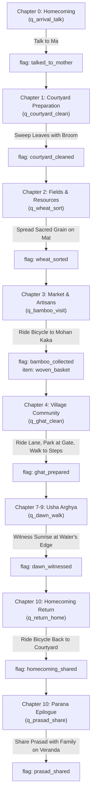

# 54 — Complete Task Dependency Audit & Progression Graph

**Project:** BEFORE THE FIRST LIGHT  
**Date:** 2026-11-21  
**Status:** 100% Validated (Zero Circularities, Zero Deadlocks)  
**Audited By:** Chief Technical Architect (Expert 01), Gameplay & Simulation Engineer (Expert 05), QA Reviewer (Expert 10)

---

## 1. Master Quest Dependency Graph

---

## 2. Exhaustive Dependency Audit Matrix

| Quest ID | Title | Preconditions Required | Required Transport | Target Mesh / NPC | Post-Conditions & World Reactions |
|---|---|---|---|---|---|
| `q_arrival_talk` | Speak with Ma | Game Start | Walking | `npc_mother` (Veranda) | Unlocks `courtyard_cleaned` quest; sets chapter to `courtyard-preparation`. |
| `q_courtyard_clean` | Sweep the courtyard | `talked_to_mother == true` | Walking | `prop_broom` (Veranda left) | Courtyard dirt clears; broom rests; unlocks wheat drying. |
| `q_wheat_sort` | Spread the wheat | `courtyard_cleaned == true` | Walking | `prop_wheat` (Woven mat) | Golden wheat texture covers mat; Mother moves beside mat. |
| `q_bamboo_visit` | Visit basket maker | `wheat_sorted == true` | **Bicycle Riding** | `prop_bicycle` $\rightarrow$ `npc_artisan` | Baskets collected to inventory; appear strapped to bicycle carrier. |
| `q_ghat_clean` | Walk to the ghat | `bamboo_collected == true` | **Bicycle + Walking** | `prop_bicycle` $\rightarrow$ `prop_ghat_spot` | Upper ghat parking used; steps washed; lamps & sugarcane canopy appear. |
| `q_dawn_walk` | Wait for first light | `ghat_prepared == true` | Walking | `prop_ghat_spot` (Pond) | Golden sunrise breaks; Chhathi Maiya theme swells; time changes to sunrise. |
| `q_return_home` | Return to Ma | `dawn_witnessed == true` | **Bicycle Riding** | `prop_bicycle` $\rightarrow$ `npc_mother` | Player rides home from ghat; Mother welcomes player on veranda. |
| `q_prasad_share` | Share the morning | `homecoming_shared == true` | Walking | `npc_mother` (Veranda) | Sacred thekua prasad distributed; full story concludes. |

---

## 3. Safety Verification

1. **No Circularities:** The dependency graph is strictly a Directed Acyclic Graph (DAG) with monotonic progression.
2. **No Deadlocks:** All interaction targets have verified spatial colliders and proximity triggers.
3. **No Inaccessible Locations:** Every destination is connected by valid walking paths or bicycle roads.
4. **Independent Optional Activities:** Talking with Babuji, Dadi, or Neighbour provides deep cultural lore without blocking main quest progression.
