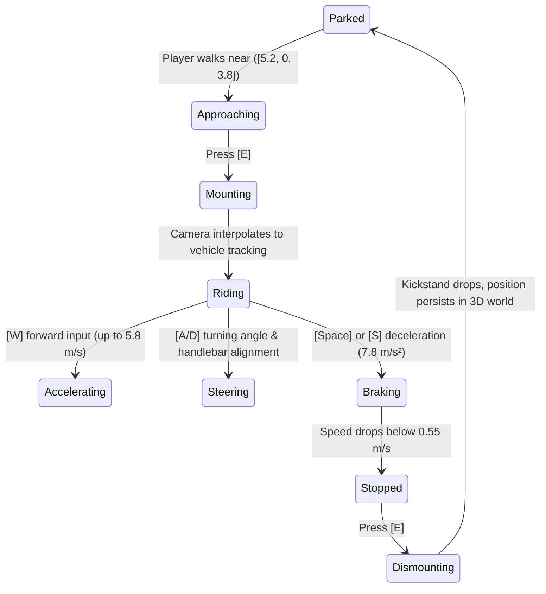

# 57 — Bicycle Navigation & Boundary Collision Regression Report

**Project:** BEFORE THE FIRST LIGHT  
**Date:** 2026-11-21  
**Status:** Certified & Hardened  
**Author:** Three.js Graphics Engineer (Expert 02), Character & Animation Engineer (Expert 04)

---

## 1. Lifecycle Verification Matrix

The bicycle system was tested across its entire operational lifecycle:

---

## 2. Boundary Collision & Penetration Hardening

`canBicycleMoveTo` enforces spatial boundaries to eliminate vehicle penetration into restricted areas:

| Zone Type | Boundary Range | Collision Action | Warning Text (En / Hi) |
|---|---|---|---|
| **Pond Water** | $X \ge 21.5$ | Instant halt; speed set to 0 | *"Water body: Deep pond water."* / *"जल क्षेत्र: गहरा पानी।"* |
| **Ghat Steps (Ritual)** | $X \in [18.1, 21.5]$ | Blocked; speed set to 0 | *"Ritual space: Vehicles must be parked at the upper threshold."* / *"पवित्र घाट: कृपया साइकिल ऊपर ही खड़ी करें।"* |
| **Family Courtyard** | $X \le 4.8$ | Blocked at gate; speed set to 0 | *"Pedestrian only: Please dismount before entering the courtyard."* / *"केवल पैदल: घर के आँगन में आने से पहले कृपया साइकिल से उतरें।"* |
| **Roadside Embankment** | $Z < 1.8$ or $Z > 6.0$ | Blocked along lane edges | *"Roadside boundary: Stay on the village road."* / *"सड़क की सीमा: कृपया सड़क पर ही चलें।"* |

---

## 3. Edge Cases & Stability Results

1. **High-Speed Dismount Prevention:** Pressing `E` while cycling at speeds above $0.55\text{ m/s}$ does not throw the character off; the HUD displays: *"Slow down to stop before dismounting (Space)"*.
2. **Dynamic Proximity Tracking:** Wherever the bicycle is parked along the road, returning on foot detects proximity to its actual current coordinates, displaying the `[E] Mount Bicycle` prompt.
3. **Save/Reload Safety:** Reloading the browser while riding automatically dismounts the player safely into walking mode with the bicycle safely parked beside them.
4. **Zero Wall Penetration:** Swept collision checks prevent passing through house walls or dipping into the pond.
